  

<h1 align="center">Jonas Schuerkamp</h1>

  IT generalist. I turn messy setups into clean containers, 
  automate everything that stands still long enough, and ship small web tools that remove a manual step.

---

## `$ cat about.md`

Boring infrastructure by design: Docker & Compose for reproducible setups, Ansible & PowerShell for automation, and a small web app whenever a process still needs a human.

- 🐳 Turning messy setups into clean, reproducible Docker containers
- ✨ Automating everything that stands still long enough — CI/CD, backups, coffee machines
- 🌐 Crafting small, no-nonsense web apps to make daily IT life easier
- 🧪 Currently exploring [herdr-office-layout](https://github.com/jonassch2903/herdr-office-layout) — pixel-art offices where terminal agents are little coworkers

## `$ docker ps`

| CONTAINER | JOB | STATE |
|:--|:--|:--|
| `homelab` | Self-hosted services, all in Docker | 🟢 running |
| `automation` | CI/CD, backups, scheduled jobs | 🟢 cron |
| `webapps` | Small tools for daily IT life | 🟢 on demand |
| `agents` | Terminal agents and pixel-art experiments | 🟡 beta |

## `$ ls ~/stack`

`docker` · `compose` · `linux` · `ansible` · `powershell` · `git` · `grafana` · `swift` (learning) · `javascript` (when a UI is needed)

## `$ echo $PHILOSOPHY`

> Build boring systems. Automate the boring parts. Keep the coffee hot.

---

The console above is a single self-contained SVG. No third-party cards, no trackers, no automated updates.
